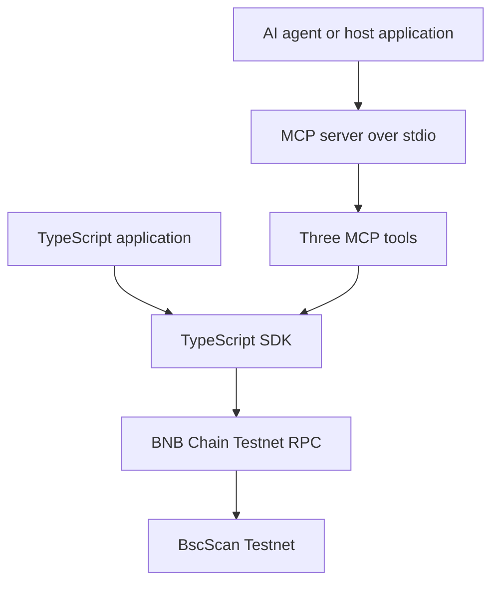

# Agent Launch Pay

A TypeScript SDK and Model Context Protocol (MCP) server for giving AI-agent applications a small set of native-payment tools on **BNB Smart Chain Testnet**.

> **Status: Testnet prototype.** The current implementation supports native tBNB on BSC Testnet (chain ID 97). It is not a production payment service and should only be used with testnet funds.

## What it does

Agent Launch Pay exposes three payment-related capabilities:

- Read the native tBNB balance of a BSC Testnet address.
- Send a native tBNB transaction using a configured signing wallet.
- Wait for a transaction to confirm and return its details and explorer link.

The same core functionality is available through a TypeScript SDK and an MCP server that communicates over standard input/output (stdio).

## Architecture



## MCP tools

| Tool | Purpose | Main input |
|---|---|---|
| `get_wallet_balance` | Reads a wallet's native tBNB balance | `address` |
| `send_payment` | Sends native tBNB from the configured agent wallet | `to`, `amount` |
| `verify_payment` | Waits for confirmation and returns transaction information | `hash` |

Example tool inputs:

```json
{ "address": "0x..." }
```

```json
{ "to": "0x...", "amount": "0.0001" }
```

```json
{ "hash": "0x..." }
```

The `send_payment` tool requires a configured private key. Treat that key as a secret and use a dedicated, test-funded wallet.

## Technology

- TypeScript
- Node.js and npm
- viem for EVM wallet and RPC operations
- Model Context Protocol SDK for the stdio server
- Zod for input validation
- BNB Smart Chain Testnet (chain ID 97)

## Project structure

```text
agent-launch-pay/
├── sdk/
│   ├── wallet/
│   ├── payments/
│   └── verification/
├── mcp-server/
│   └── index.ts
├── examples/
│   └── demo-agent/
├── tests/
├── .env.example
├── package.json
└── tsconfig.json
```

## Requirements

- Node.js 20 or later
- npm
- Access to a BSC Testnet RPC endpoint
- A BSC Testnet wallet funded with tBNB for payment testing

## Installation

```bash
git clone https://github.com/Timrossid/agent-launch-pay.git
cd agent-launch-pay
npm install
```

## Configuration

Create a local environment file from the example:

```bash
cp .env.example .env
```

Configure the following values:

```env
BSC_TESTNET_RPC_URL=
AGENT_PRIVATE_KEY=
DEMO_WALLET_ADDRESS=
DEMO_RECIPIENT_ADDRESS=
```

Use a dedicated test wallet. Never commit `.env`, private keys, seed phrases, or funded-wallet credentials.

## Run the project

Type-check and build:

```bash
npm run typecheck
npm run build
```

Run the balance example:

```bash
npm run dev
```

Run the payment example after configuring and funding the test wallet:

```bash
npm run demo:payment
```

### Start the MCP server

Run the server directly with:

```bash
npx tsx mcp-server/index.ts
```

The server uses stdio. Configure the command and working directory in your MCP host's server configuration. The repository does not define an `npm run mcp` script.

## Testnet transaction evidence

A successful native tBNB transfer was recorded on BSC Testnet:

| Field | Value |
|---|---|
| Network | BNB Smart Chain Testnet |
| Chain ID | 97 |
| Amount | 0.00001 tBNB |
| Status | Successful |
| Block | 125001606 |
| Gas used | 21,000 |

[View the transaction on BscScan Testnet](https://testnet.bscscan.com/tx/0x41e8b79ec9c57bad786f57abc137006472293a25e0bb3c2a94bcde9f5b74ddc2).

This transaction is evidence of a testnet transfer. It does not imply support for mainnet assets or production payment processing.

## Current scope and limitations

The repository currently focuses on native tBNB transfers and transaction verification on BSC Testnet. It does not claim to provide:

- ERC-20 token payments.
- Multi-chain payment routing.
- Smart-contract escrow or programmable payment conditions.
- Production custody, key management, spending limits, or approval policies.
- Fiat conversion, banking integrations, or compliance screening.
- A hosted web dashboard or public hosted demo.

These would require additional implementation, testing, and security review.

## Contributing

Contributions are welcome. Please include a clear description of the change, keep credentials out of commits, and add or update tests for changed behavior. Do not use real funds when testing.

## License

See the repository's [LICENSE](LICENSE) file.
